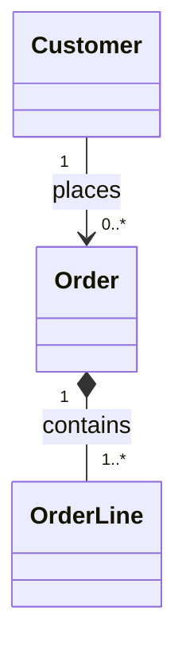

# Domain Model

`GLOSSARY.md` says what words mean. `docs/domain-model.md` says how those concepts fit
together and what must always be true about them. It is conceptual: it describes the
domain, not the code, the database or the API.

## Rules

- **Glossary first.** Every concept in the model is a term in `GLOSSARY.md`, spelled
  exactly as there. Don't define terms here; if a concept has no glossary entry, resolve
  it with the `domain-modeling` skill first.
- **No implementation.** No tables, classes, columns, endpoints or technologies. If it would
  change when we swap a database or framework, it doesn't belong here.
- **Current state only.** The file describes the domain as the system implements it today.
  Proposed changes live in the design doc until they are built.
- **Create lazily.** Create the file when the first relationship or invariant is settled.
- **Surface contradictions.** If code, design or conversation contradicts the model, say so
  and resolve it; don't silently pick one.

## When to update

Update in the same change that builds it, whenever any of these change:

- a concept is added, removed, split or merged
- a relationship between concepts, or its cardinality, changes
- an invariant (a rule that must always hold) is added, changed or dropped
- a lifecycle (the states a concept moves through) changes

## Format

````md
# Domain Model

{One or two sentences: what part of the world this models.}

## Concepts and relationships



- **Customer** places zero or more **Orders**.
- An **Order** contains one or more **OrderLines**; lines don't exist without their order.

## Invariants

- An **Order** always has at least one **OrderLine**.
- A cancelled **Order** is never fulfilled.

## Lifecycles

**Order**: Draft → Placed → (Fulfilled | Cancelled)
````

- The Mermaid diagram uses only concept names, relationship labels and cardinalities: no
  attributes or methods.
- Every relationship in the diagram has a matching sentence in the list, and vice versa.
- Invariants are one sentence each, stated as what is always or never true.
- Omit **Lifecycles** until a concept has meaningful states.
- Group by area under subheadings when the model grows; split into one file per area under
  `docs/domain-model/` only when one diagram passes ~15 concepts.
